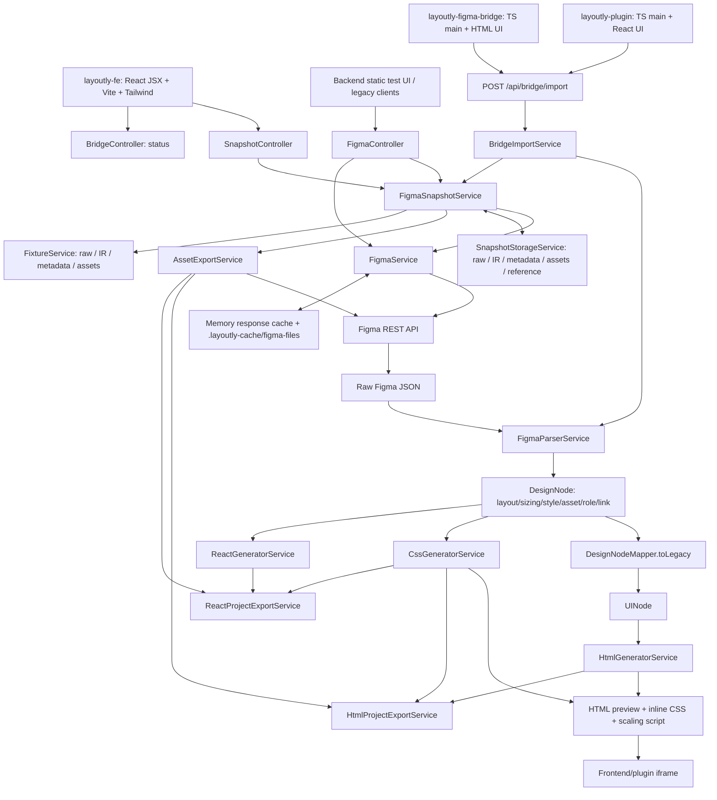
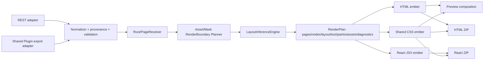

# Layoutly Architecture Audit

Ngày audit: 2026-10-09, Windows, Asia/Bangkok. Trạng thái: **audit đầu tiên, chưa triển khai sửa code**.

## 1. Kết luận

Layoutly đã có pipeline hoạt động: REST hoặc Figma Plugin -> snapshot lưu đĩa -> Design IR -> HTML/CSS hoặc React/Vite -> preview và ZIP. Không cần rewrite. Phần cần đầu tư tiếp theo là **độ đầy đủ của dữ liệu, tính nhất quán của render pipeline và baseline đo chất lượng**, không phải tích hợp AI ngay.

Các vấn đề ưu tiên: escape/isolation của preview; trạng thái assets sau restart/refresh; chọn root khác nhau giữa preview và export; font/rich text; Grid; serializer dự phòng của Bridge. Một Layout Inference Engine nội bộ dùng chung có thể bổ sung dần vào các service hiện tại.

**Chưa có bằng chứng đạt độ giống Figma 100%.** Build thành công, test chuỗi CSS pass và ảnh tải đủ không thay thế phép so sánh pixel với ảnh Figma gốc. Các khung chữ nhật quanh TEXT đã được xử lý trong working tree hiện tại bằng `-webkit-text-stroke`; không nên báo cáo lỗi cũ đó là còn nguyên.

Kế hoạch có dependency và nghiệm thu: [LAYOUTLY_IMPLEMENTATION_ROADMAP.md](LAYOUTLY_IMPLEMENTATION_ROADMAP.md).

## 2. Phạm vi và bảo toàn dữ liệu

Đã đọc source, test, fixture, manifest, build/config và README của bốn module first-party: `layoutly-be`, `layoutly-fe`, `layoutly-plugin`, `layoutly-figma-bridge`. Ba lockfile được parse để kiểm tra dependency/version, không coi từng dòng dependency bên thứ ba là source ứng dụng. Đã đối chiếu working tree, diff, các call site và output build/test.

`repos/` là các clone tham khảo chưa tracked: `FigmaToCode`, `grida`, `figma-to-react`, `Figma-Context-MCP`, `figma-mcp-glips`. Không có submodule, dependency/import hay runtime integration từ các clone này trong pipeline được audit. Không audit toàn bộ implementation của năm dự án ngoài; không kế thừa tuyên bố test trong tài liệu thuyết trình. Các file PPTX/PDF/HTML thuyết trình và script tạo slide được inventory, không dùng làm bằng chứng implementation.

Branch lúc bắt đầu: `features/figma-plugins`, HEAD `ed6cdf9`, ahead 5 so với upstream đã lưu cục bộ. Không fetch/pull/merge/push trong audit; đây không phải xác nhận trạng thái GitHub mới nhất.

Working tree có **14 file tracked đã sửa**, 2 source/test Java mới chưa tracked và các tài liệu/clone bên ngoài:

| Nhóm | File đã tồn tại trước audit |
| --- | --- |
| Controller | `layoutly-be/src/main/java/com/tgnguyen/layoutlybe/controller/SnapshotController.java` |
| Models/adapters | `layoutly-be/src/main/java/com/tgnguyen/layoutlybe/model/UINode.java`; `model/ir/AssetSpec.java`, `DesignNodeMapper.java`, `StyleSpec.java` trong cùng Java package |
| Services | `layoutly-be/src/main/java/com/tgnguyen/layoutlybe/service/CssGeneratorService.java`, `FigmaParserService.java`, `FigmaSnapshotService.java`, `HtmlGeneratorService.java` |
| Tests | `layoutly-be/src/test/java/com/tgnguyen/layoutlybe/service/CssGeneratorServiceTest.java`, `FigmaParserServiceTest.java` |
| Frontend | `layoutly-fe/src/App.jsx`, `layoutly-fe/src/index.css`, `layoutly-fe/src/lib/api.js` |
| Java chưa tracked | `layoutly-be/src/main/java/com/tgnguyen/layoutlybe/model/ir/ShadowSpec.java`; `layoutly-be/src/test/java/com/tgnguyen/layoutlybe/service/HtmlGeneratorServiceTest.java` |
| Khác chưa tracked | `create_pptx_slides.py`, `layoutly_presentation_slides.html`, `layoutly_presentation_slides.pptx`, `lo_trinh_15_tuan_design_to_code.pdf`, `repos/` |

Diff ban đầu: 899 additions, 398 deletions trên 14 file tracked. Audit không reset, xóa, ghi đè source, thay schema, tự động commit hoặc chạy formatter/lint fix. Chỉ thêm hai tài liệu trong `docs/`. Build/test tạo lại output generated/ignored và probe tạo snapshot tạm riêng, không sửa snapshot mẫu của người dùng. Đối chiếu SHA-256 đầu/cuối cho 117 file first-party đã có trước audit: **0 file đổi nội dung, 0 file mất, 0 source mới ngoài hai tài liệu**. Git status cuối vẫn giữ các thay đổi người dùng và thêm `docs/`.

## 3. Kiến trúc thực tế



Java backend là Spring MVC với WebClient/Reactor cho outbound async, không phải một ứng dụng WebFlux thuần. `starter-web` và `starter-webflux` cùng tồn tại để phục vụ hai mục đích này. Source web và UI plugin hiện là **JSX/JavaScript**, không phải TypeScript toàn bộ; TypeScript hiện nằm ở Figma main thread. Generated React project cũng dùng JSX, CSS thường, React Router, không sinh Tailwind utilities.

### 3.1 REST

1. `layoutly-fe/src/lib/api.js:111` gửi `POST /api/figma/import`, body hỗ trợ `fileKey`, `figmaUrl`, `nodeId`; token qua `X-Figma-Token`.
2. `SnapshotController.java:77,193` chuẩn hóa URL/node. `FigmaSnapshotService.java:66` cache theo file/root, nhưng vẫn fetch/parse **toàn bộ file**, không dùng `/nodes` cho import selection.
3. `FigmaService.java:192` ưu tiên memory/disk raw cache. Refresh riêng gọi `fetchFileFresh`; TTL tổng quát không áp dụng cho raw file cache. Đây là snapshot workflow có chủ đích, không phải dữ liệu live.
4. `FigmaParserService.java:27` đọc `document` thành `DesignNode`. Snapshot giữ full IR và metadata root được chọn.
5. `SnapshotStorageService.java:42` lưu raw, IR, metadata. Lần load sau `FigmaSnapshotService.java:244` **parse lại raw**, không đọc persisted IR làm nguồn sự thật.
6. CSS/text/code không nhất thiết tải assets. Snapshot preview có thể dùng URL render Figma; export gọi download assets. REST `/file/.../preview` legacy tải/caches assets trước, khác snapshot preview.
7. Assets được render PNG theo node ID, batch 100 ID, download concurrency 6. Export cả full IR ngay cả khi chỉ xuất một root; bytes được đóng ZIP trong RAM.

### 3.2 Bridge

1. Figma main thread đọc node, export `JSON_REST_V1`, assets, optional reference PNG; không gọi REST và không cần PAT.
2. UI thread gửi multipart `metadata`, `designJson`, `assets`, `referenceImage` tới `/api/bridge/import`.
3. `BridgeImportService.java:53` kiểm tra part/size/source/MIME khai báo/path; parse bằng cùng `FigmaParserService`, tạo snapshot `FIGMA_PLUGIN` với assets local.
4. Limits hiện tại: metadata 256 KiB, design 50 MiB, reference 15 MiB, mỗi asset 12 MiB, total 100 MiB, 500 assets. Limits bytes chưa tương đương limits node/depth/pixel-memory.
5. Snapshot có reference trên đĩa nếu gửi lên, nhưng `FixtureService` không sao chép reference vào fixture. Chưa có endpoint reference hoặc runner dùng nó để tính visual diff.
6. Generate/preview/export Bridge dùng snapshot và assets local. Các test mock hiện có kiểm tra không gọi Figma, nhưng chưa kiểm chứng plugin live trong Figma Desktop ở lần audit này.

Figma xác nhận `JSON_REST_V1` là export object dành cho reuse REST pipeline, không phải gọi mạng REST từ plugin. [Figma ExportSettings](https://developers.figma.com/docs/plugins/api/ExportSettings/).

### 3.3 Generator, preview và export không hoàn toàn đồng nhất

| Bề mặt | Root/asset policy thực tế | Hệ quả |
| --- | --- | --- |
| Snapshot tree/structure/code | REST dùng metadata root; Plugin dùng nguyên IR | Cùng selection nhưng wrapper/source khác nhau có thể cho thống kê và page khác nhau |
| Snapshot preview | Nếu selectedRoot chính là IR thì heuristic chọn FRAME theo width/name/height; còn lại giữ selectedRoot | Thay viewport có thể đổi screen; Canvas được REST chọn rõ không chạy heuristic |
| Legacy `/file/.../preview` | Full IR + assets đã tải; không dùng heuristic snapshot preview | Preview legacy không đại diện snapshot preview |
| HTML ZIP AUTO | DOCUMENT: CANVAS có <=1 top FRAME thành một page; >1 FRAME tách từng frame; selected FRAME thành một page | Decoration/sibling có thể thuộc output khác React |
| React ZIP | DOCUMENT: top FRAME của từng CANVAS là page; nếu không có thì CANVAS; CANVAS trực tiếp fallback nguyên root | Cùng document một top FRAME + sibling khác cho output khác HTML AUTO |
| CSS endpoint | Snapshot chỉ local assets đã cache; legacy không có asset URL | Copy HTML + CSS từ code tabs trước khi tải assets có thể không có hình |
| ZIP assets | Snapshot full IR, không prune theo exported pages | Có thể gọi Figma/download nhiều asset không dùng |

Bằng chứng: [SnapshotController.java](../layoutly-be/src/main/java/com/tgnguyen/layoutlybe/controller/SnapshotController.java#L123), [FigmaController.java](../layoutly-be/src/main/java/com/tgnguyen/layoutlybe/controller/FigmaController.java#L163), [HtmlGeneratorService.java](../layoutly-be/src/main/java/com/tgnguyen/layoutlybe/service/HtmlGeneratorService.java#L114), [ReactGeneratorService.java](../layoutly-be/src/main/java/com/tgnguyen/layoutlybe/service/ReactGeneratorService.java#L202).

## 4. Hai plugin và adapters

### 4.1 So sánh plugin

| Điểm | `layoutly-plugin` | `layoutly-figma-bridge` |
| --- | --- | --- |
| UI | React, code tabs, preview, download ZIP ngay trong plugin | HTML thuần, scope/progress/sync, mở web bằng snapshotId |
| Trigger | Auto-sync debounce 500 ms khi selection/scope đổi | Người dùng bấm Sync |
| Root | Bọc selection thành DOCUMENT -> CANVAS -> node | Selection trả node; Page serializer trả CANVAS |
| Native export | `code.ts:28`, không có fallback | `src/code.ts:126`: native cho selection; Page luôn manual serializer |
| Manual serializer | Không có | Có nhưng thiếu nhiều trường; không có capability/loss report theo field |
| Assets | Tất cả PNG, scale 2; export lỗi làm fail toàn request | Vector SVG, ảnh PNG scale 1; lỗi riêng thành warnings; dedup ID |
| Reference | Selection PNG scale 1, bỏ nếu >15 MiB | Selection, giới hạn chiều rộng 1600; không ghi scale/crop chính xác vào metadata |
| Metadata | `fileKey:null`, `nodeType` giữ kiểu Plugin API | Có `figma.fileKey`, PAGE -> CANVAS |
| Backend URL | Hardcode `http://localhost:8080` | Editable; Open Layoutly giả định localhost:5173 |
| Build | tsc + Vite singlefile; lock Vite 8.3.1 | tsc noEmit + esbuild IIFE |
| Manifest | ID plugin có sẵn; chỉ localhost:8080 dev | Không ID; localhost:8080/5173 dev |

Trùng lặp: selection traversal, serializer wrapper, asset detection/export/naming, reference capture, multipart transport, progress/error handling, API client. Không có shared package/protocol definition hoặc parity test. Không nên gộp bằng cách xóa Bridge ngay: Bridge đang có warnings/fallback/config tốt hơn, còn plugin React giữ workflow code/preview/ZIP tiện hơn.

**Không kết luận PageNode không hỗ trợ native export.** API hiện có overload REST export; với `dynamic-page` cần chú ý `loadAsync`. Bridge tự bỏ qua native cho PAGE; plugin React dùng `any`, không thể coi compile pass là chứng minh Page live hoạt động. [Figma PageNode](https://developers.figma.com/docs/plugins/api/PageNode/).

### 4.2 DesignNode, UINode và compatibility

| Model | Vai trò hiện tại | Giới hạn |
| --- | --- | --- |
| `DesignNode` | IR immutable Lombok, chứa bounds/layout/sizing/style/asset/role/link/transition | Thiếu text runs, paint stack, grid tracks, mask groups, transform, component/token provenance |
| `UINode` | DTO mutable legacy `/tree`, HTML traversal, overloads | Có style mới nhưng không giữ layout type/direction/alignment/wrap/constraints/sizing modes |
| `FigmaNode` | Typed raw DTO cho structure analytics | Không phải nguồn IR generator; thêm field ở đây không tự cải thiện rendering |
| `toLegacy` | HTML generator và legacy clients | Giữ padding/gap, text/style/renderBounds/links nhưng mất layout/sizing semantics |
| `fromLegacy` | CSS overload nhận UINode | Dựng ABSOLUTE/NONE và FIXED/UNKNOWN; asset kind chuyển RASTERIZED |

Probe đã chạy: `AUTO_FLEX -> toLegacy -> fromLegacy -> ABSOLUTE`. Không có contract round-trip test. **Không suy ra tất cả CSS hiện bị mất Auto Layout**: snapshot/ZIP gọi CSS với DesignNode trực tiếp; HTML gọi adapter nhưng không lấy Flexbox từ UINode. Loss xảy ra ở legacy round-trip/overload và là rủi ro khi refactor generator.

Working tree đã thêm field tương thích qua adapter và giữ constructor `AssetSpec(boolean,String)` cùng `ImportRequest(fileKey,figmaUrl)`. Đây là compatibility ở Java call site, chưa là kế hoạch version cho JSON consumers hoặc persisted schema.

## 5. Trường dữ liệu và độ đúng rendering

Bảng này đối chiếu **code Layoutly hiện tại**, không khẳng định mọi trường đều xuất hiện trên mọi loại node/file. Field chưa có dữ liệu phải được phân biệt với field có nhưng unsupported. Các trường Grid/rich text/render bounds được đối chiếu với [Figma node types](https://developers.figma.com/docs/rest-api/file-node-types/); đơn vị text với [Figma property types](https://developers.figma.com/docs/rest-api/file-property-types/).

| Nhóm | Đã làm được | Bỏ qua/chuyển đổi chưa đủ | Bằng chứng code |
| --- | --- | --- | --- |
| Typography cơ bản | Family, size, weight, lineHeightPx, letterSpacing px, horizontal align, italic, textAutoResize | Không đóng gói font/load font; font fallback không cảnh báo; không giữ line-height unit/original intent | `FigmaParserService.java:211`; `CssGeneratorService.java:655` |
| Rich text | Plain `characters` | `characterStyleOverrides`, `styleOverrideTable`, range fills/font, decoration/case, paragraph/list spacing, indent, vertical align, truncation/maxLines, hyperlink/OpenType chưa thành IR/render | `DesignNode.java:15`; `StyleSpec.java:10` |
| Auto Layout | Row/column, gap, padding, align, wrap, absolute child, HUG/FILL, legacy grow/stretch, min/max | Wrap cross-axis spacing/align-content, negative spacing, stroke sizing, z-order; CSS FILL=100% + flex-grow không có size plan tổng thể; fixed child default shrink có thể lệch | `FigmaParserService.java:133,172`; `CssGeneratorService.java:567,710` |
| Grid | Parse mode thành AUTO_GRID, đếm gridCount | Không có tracks/gaps/anchors/spans/auto-flow trong LayoutSpec; CSS chỉ triển khai AUTO_FLEX. Không nhầm layout guide grid với Auto Layout GRID | `LayoutSpec.java:8`; `CssGeneratorService.java:569` |
| Constraints/geometry | LEFT/RIGHT/CENTER/stretch/SCALE theo bounds; corner rotation bội 90 độ | Parent null/zero, arbitrary rotation/transform, local dimensions; heuristic 95% có thể ghi đè LEFT/FIXED rõ ràng; offset root không được dùng | `CssGeneratorService.java:491,511,554`; `FigmaParserService.java:234` |
| Mask/clipping | visible=false, clipsContent=true, ellipses, 4 corner radii | Không giữ isMask/maskType và sibling-mask boundary; clipsContent không thay mask; smoothing/arc chưa render | `StyleSpec.java:24`; `FigmaParserService.java:270` |
| Effects/paints | First visible SOLID, paint alpha, DROP/INNER shadow, text glyph stroke | Multi-fill/gradient/blend modes/blur chưa hỗ trợ; TEXT shadow sinh box-shadow, strokeAlign/per-side weights thiếu; raster opacity có thể áp lại | `FigmaParserService.java:253,387`; `CssGeneratorService.java:618,642` |
| Assets | REST PNG, Bridge PNG/SVG, cached files, expanded absoluteRenderBounds bằng ::before | Không phân biệt node render với source image fill; image crop/transform không thành IR; subtree raster vẫn có children DOM; lỗi download bị bỏ qua | `AssetExportService.java:55,114`; `CssGeneratorService.java:694`; generators vẫn recurse |
| Components/tokens | Flatten instance tree, name-based role, một interaction click | Không map component props/variants/reusable components, variables/modes/style IDs; không có AI inference thật | `RoleClassifier.java`; `FigmaParserService.java:73`; `layoutly-fe/src/App.jsx:733` |

Bridge manual serializer `layoutly-figma-bridge/src/code.ts:139` còn bỏ `absoluteRenderBounds`, effects, individual corners, clipsContent, rotation, interactions; typography chỉ đọc giá trị non-mixed và PIXELS, thiếu font style/align/autoResize và percent conversion. Vì PAGE luôn đi nhánh này, parser tốt hơn vẫn không thể khôi phục dữ liệu đã mất trước upload.

## 6. Vì sao absolute/scaling chiếm ưu thế

1. Parser quyết định ABSOLUTE cho renderable container có children nhưng không explicit Auto Layout (`FigmaParserService.java:146`). Chưa có inference theo quan hệ hình học giữa siblings.
2. CSS chỉ đưa child vào flow khi parent AUTO_FLEX và child không ABSOLUTE (`CssGeneratorService.java:477`). GRID không được xử lý như flow.
3. Absolute bounding box trở thành width/height và offset child-parent; original local transform không được giữ. DOM nesting giống layer tree không nhất thiết là cấu trúc semantic layout của web.
4. FILL/HUG mới được map cục bộ, chưa giải constraints/min-content/cross-axis tổng thể; metadata mất ở legacy adapter làm khả năng suy luận kém hơn khi đi overload đó.
5. HTML và React export đều giữ design width/height, gọi `transform:scale(min(1, available/designWidth))`. Đây là **fit-to-width preview**, không phải mobile layout: font, button, spacing cùng bị thu nhỏ.
6. Root/page detection nằm ở controller và từng generator; chưa có screen/coordinate plan dùng chung. `--figma-offset-x/y` được ghi nhưng không có consumer. Hidden/out-of-frame children vẫn tham gia union bounds.

Smoke đo từ ZIP Studio hiện tại, viewport 460 px: HTML và React đều 650 DOM node, 647 absolute (~99.5%), 2 flex, 0 grid, 55 ảnh tải đủ, không x-overflow, không pageerror. Đây là một case cụ thể, **không phải tỷ lệ toàn bộ thiết kế Figma**. Preview width 375 có scale 0.260417, không thể gọi đó là mobile reflow thành công.

Hướng đúng: giữ absolute cho overlay/freeform cần fidelity; dùng explicit Flex/Grid trước; chỉ inference nơi không có metadata; tách chế độ fidelity và responsive để không âm thầm thay mục tiêu output.

## 7. Findings P0/P1/P2

P0 = sự cố khẩn cấp/toàn hệ thống đang có bằng chứng; P1 = correctness/security/measurement cần làm trước khi mở rộng; P2 = compatibility, UX và maintainability. Không ép số lượng finding theo mức.

### P0

**Không xác nhận P0 trong môi trường local của lần audit này.** Điều đó không có nghĩa backend đủ an toàn để public. A01/A11 là gate chặn triển khai ra môi trường không tin cậy.

### P1

| ID | Vấn đề và bằng chứng | Tác động / xác minh |
| --- | --- | --- |
| A01 | Attribute escaping/isolation: [HtmlGeneratorService.java:339,551](../layoutly-be/src/main/java/com/tgnguyen/layoutlybe/service/HtmlGeneratorService.java#L339) dùng escape chỉ `&<>` cho attribute. [App.jsx:287,340](../layoutly-fe/src/App.jsx#L287) iframe không sandbox; plugin `src/App.jsx:120` srcDoc cũng không sandbox. CSS font string không bảo vệ inline `</style>` ở `CssGeneratorService.java:840` | Probe tên `x" data-audit="injected` sinh attribute mới, đã tái hiện, không thực thi script. Script injection từ thiết kế/payload không tin cậy có nguy cơ truy cập parent cùng origin. CSP của **asset** không bảo vệ preview HTML. Cần context-specific encoders và sandbox/preview origin riêng, vẫn cho scaling script được kiểm soát |
| A02 | Assets sau restart sai trạng thái: [SnapshotStorageService.java:111](../layoutly-be/src/main/java/com/tgnguyen/layoutlybe/service/SnapshotStorageService.java#L111) luôn trả bundle; [FigmaSnapshotService.java:251,136](../layoutly-be/src/main/java/com/tgnguyen/layoutlybe/service/FigmaSnapshotService.java#L251) cache non-null và bỏ fetch | Probe REST: trước restart assets=null; sau restart bundle rỗng non-null dù expected 1 image; getAssets trả 0 file, exporter không được gọi. Missing file trên đĩa vẫn có URL mapping. Cần UNKNOWN/PARTIAL/COMPLETE và warnings/recovery |
| A03 | Refresh/cache revision: [FigmaSnapshotService.java:103,258](../layoutly-be/src/main/java/com/tgnguyen/layoutlybe/service/FigmaSnapshotService.java#L103) refresh giữ ID/asset URL; [SnapshotController.java:149](../layoutly-be/src/main/java/com/tgnguyen/layoutlybe/controller/SnapshotController.java#L149) cache immutable 1 năm | Browser có thể giữ bitmap cũ sau refresh; assets render API không pin figmaVersion nên tree và bitmap có thể khác revision. Static evidence; chưa chạy live refresh. Cần content/revision URL và test concurrency refresh-export |
| A04 | Root/page policy chia tách: [SnapshotController.java:128,211](../layoutly-be/src/main/java/com/tgnguyen/layoutlybe/controller/SnapshotController.java#L128); HTML AUTO `HtmlGeneratorService.java:129`; React `ReactGeneratorService.java:202` | Preview có thể chọn nested screen trong cover trong khi ZIP xuất cover; REST selection và Plugin wrapper khác behavior; explicit CANVAS không giống native selection heuristic. Test hiện chỉ khẳng định preview title, không kiểm parity ZIP. Cần một root/page plan |
| A05 | Thiếu đo baseline: [FixtureService.java:38](../layoutly-be/src/main/java/com/tgnguyen/layoutlybe/service/FixtureService.java#L38) không copy reference; [FixtureLoaderTest.java](../layoutly-be/src/test/java/com/tgnguyen/layoutlybe/fixture/FixtureLoaderTest.java) chỉ kiểm type/direction | Fixture horizontal IR ghi children=[] không đối chiếu với parsed tree; không reference PNG, font manifest, Playwright test/dependency/CI tracked. Không thể phát biểu % fidelity hoặc đánh giá AI có cải thiện |
| A06 | Typography/font pipeline thiếu: [FigmaParserService.java:211](../layoutly-be/src/main/java/com/tgnguyen/layoutlybe/service/FigmaParserService.java#L211), [StyleSpec.java](../layoutly-be/src/main/java/com/tgnguyen/layoutlybe/model/ir/StyleSpec.java), [CssGeneratorService.java:672](../layoutly-be/src/main/java/com/tgnguyen/layoutlybe/service/CssGeneratorService.java#L672) | Family string không cung cấp font binary; rich text bị collapse; text vertical align/decoration/case/truncation thiếu. Hai ZIP smoke có 0 registered FontFace; điều này không chứng minh font system thiếu, nhưng không có bundled webfont. Font fallback làm thay wrap/bounds dù tọa độ đúng |
| A07 | Grid nhận diện nhưng không render: [FigmaParserService.java:144](../layoutly-be/src/main/java/com/tgnguyen/layoutlybe/service/FigmaParserService.java#L144), [LayoutSpec.java](../layoutly-be/src/main/java/com/tgnguyen/layoutlybe/model/ir/LayoutSpec.java), [CssGeneratorService.java:569](../layoutly-be/src/main/java/com/tgnguyen/layoutlybe/service/CssGeneratorService.java#L569) | Probe AUTO_GRID nhưng CSS không `display:grid`. Grid count trong UI có thể khiến người dùng tưởng đã hỗ trợ. Cần preserve tracks/placement và fallback diagnostic |
| A08 | Bridge PAGE/fallback mất dữ liệu: [layoutly-figma-bridge/src/code.ts:126,139,190](../layoutly-figma-bridge/src/code.ts#L126) | PAGE luôn manual; thiếu field style/render/link và bỏ mixed/percent text. Không chỉ backend bug. Static evidence; chưa có Figma live parity test |
| A09 | Không có render boundary: [FigmaParserService.java:270](../layoutly-be/src/main/java/com/tgnguyen/layoutlybe/service/FigmaParserService.java#L270), HTML `HtmlGeneratorService.java:354`, React `ReactGeneratorService.java:128`, CSS `CssGeneratorService.java:618` | Frame có IMAGE fill được export thành ảnh chứa children nhưng DOM vẫn render children; opacity có thể áp hai lần. Masks/gradient/blur không được giữ hoặc fallback có chủ đích. Là điều kiện lỗi từ code, không khẳng định đã xảy ra trên mọi ảnh Studio |
| A10 | Bounds/constraints thiếu guard và normalization: [CssGeneratorService.java:491,516,545,554](../layoutly-be/src/main/java/com/tgnguyen/layoutlybe/service/CssGeneratorService.java#L491); [HtmlGeneratorService.java:413](../layoutly-be/src/main/java/com/tgnguyen/layoutlybe/service/HtmlGeneratorService.java#L413) | Probe parent có x/width nhưng thiếu y/height gây NPE. SCALE parent size=0 có thể sinh số không finite; 95% override explicit LEFT; union bounds gồm hidden/overflow, offset unused. Cần reject/diagnostic finite bounds và local geometry plan |
| A11 | Trust boundary/cache không owner: [CorsConfig.java:16](../layoutly-be/src/main/java/com/tgnguyen/layoutlybe/config/CorsConfig.java#L16), [BridgeController.java:25](../layoutly-be/src/main/java/com/tgnguyen/layoutlybe/controller/BridgeController.java#L25), [FigmaService.java:192](../layoutly-be/src/main/java/com/tgnguyen/layoutlybe/service/FigmaService.java#L192), [FigmaSnapshotServiceTest.java](../layoutly-be/src/test/java/com/tgnguyen/layoutlybe/service/FigmaSnapshotServiceTest.java) | Cache reuse across tokens được test có chủ đích; snapshot API không auth; global CORS `*` và rule Bridge riêng chưa có integration preflight test; token raw giữ memory không bounded. Local cache tiện nhưng không là tenant isolation. Chặn public hosting tới khi có owner/auth/origin policy; không tuyên bố đã exploit remote |
| A12 | Flex fidelity chưa đủ: [FigmaParserService.java:153,199](../layoutly-be/src/main/java/com/tgnguyen/layoutlybe/service/FigmaParserService.java#L153), [CssGeneratorService.java:567,723,737](../layoutly-be/src/main/java/com/tgnguyen/layoutlybe/service/CssGeneratorService.java#L567) | Không counter-axis wrap gap/content align; negative Figma itemSpacing đi thẳng CSS gap không hợp lệ; FILL width=100% + flex:1 và default shrink chưa có constraint solver. Cần fixture cho wrapped/mixed sizing, không chỉ assert có chuỗi flex |

### P2

| ID | Vấn đề và bằng chứng | Tác động / hành động |
| --- | --- | --- |
| A13 | Adapter lossy: [DesignNodeMapper.java:68](../layoutly-be/src/main/java/com/tgnguyen/layoutlybe/model/ir/DesignNodeMapper.java#L68); CSS legacy overload `CssGeneratorService.java:404` | Probe AUTO_FLEX -> ABSOLUTE; constraints/minmax/wrap/asset kind không round-trip. Giữ legacy API nhưng không dùng nó làm core IR; thêm contract tests và explicit loss diagnostics |
| A14 | Scaling và duplication: [HtmlGeneratorService.java:21](../layoutly-be/src/main/java/com/tgnguyen/layoutlybe/service/HtmlGeneratorService.java#L21), [ReactProjectExportService.java:131](../layoutly-be/src/main/java/com/tgnguyen/layoutlybe/service/ReactProjectExportService.java#L131); CSS file 386 dòng implementation cũ comment-out | Fit-to-width có ích cho fidelity, nhưng chưa responsive; hai runtime scale gần trùng nhau và bounds/naming/page detection trùng. Refactor nhỏ sau baseline, không xóa fallback absolute |
| A15 | Download lỗi im lặng: [AssetExportService.java:64,121](../layoutly-be/src/main/java/com/tgnguyen/layoutlybe/service/AssetExportService.java#L121); [SnapshotResponse.java](../layoutly-be/src/main/java/com/tgnguyen/layoutlybe/dto/SnapshotResponse.java) luôn SYNCED | Null render URL/failed download bị bỏ, bundle cached và ZIP vẫn trả thành công. Không có expected-vs-present result per asset. Cần warnings/partial status/strict export mode, tương thích additive |
| A16 | Validation chưa đủ: [BridgeImportService.java:141,198](../layoutly-be/src/main/java/com/tgnguyen/layoutlybe/service/BridgeImportService.java#L141); `FigmaSnapshotService.java:221,339`; `SnapshotController.java:164` | Không verify bytes/MIME extension/asset node membership/duplicate nodeId; không enforce node budget trước traversal; composite instance ID có `;` bị node regex reject; invalid node bị wrap thành500; format lạ thànhHTML. Cần negative payload/HTTP tests, không chỉ direct service mock |
| A17 | Build/test tooling: [layoutly-fe/package.json](../layoutly-fe/package.json), [layoutly-plugin/eslint.config.js](../layoutly-plugin/eslint.config.js), plugin `package.json`, Bridge `scripts/build.mjs:18` | FE không test/lint scripts; plugin lint22errors, JSX không có React lint setup; plugin typings wildcard/Vite8 khác FE5; không CI tracked. Bridge watch chỉ esbuild code, UI copy không watch lại và không typecheck. Build pass không Figma-host pass |
| A18 | UI trạng thái không phản ánh validation và async race: [layoutly-fe/src/App.jsx:447,522,733](../layoutly-fe/src/App.jsx#L447); [layoutly-plugin/src/App.jsx:215,239,255](../layoutly-plugin/src/App.jsx#L215) | Test token chỉ kiểm nonempty, không `/me`; AI suggestions tĩnh; loadCode không gắn kết quả với snapshot hiện hành; plugin guard trước structure await nhưng không sau, code fetch không cancel; React status bị ghi đè HTML. Cần component/API tests |
| A19 | HTML/React semantics và prototype approximation: HTML `HtmlGeneratorService.java:394`, React `ReactGeneratorService.java:103`, [TransitionCssMapper.java:23](../layoutly-be/src/main/java/com/tgnguyen/layoutlybe/service/TransitionCssMapper.java#L23), `FigmaParserService.java:73` | HTML BUTTON nhưng React div; heuristic empty border box -> input/checkbox có thể nhầm decoration, input drop subtree. Chỉ first supported click action; SMART_ANIMATE thành fade, direction không giữ, spring xấp xỉ. Không coi là Figma interaction parity |
| A20 | Snapshot reproducibility/transaction/cache index: [SnapshotStorageService.java:42,91](../layoutly-be/src/main/java/com/tgnguyen/layoutlybe/service/SnapshotStorageService.java#L42), [FigmaSnapshotService.java:125,230,244,282](../layoutly-be/src/main/java/com/tgnguyen/layoutlybe/service/FigmaSnapshotService.java#L125) | Files atomic riêng lẻ, memory publish trước save hoàn tất; không parser/schema version; restart reparse đổi output; latest selected snapshot có thể che full snapshot do filter sau max; selected cache disk chưa keyed root. Cần versioned manifest và migration không overwrite raw |

Findings có thể chia thành PR nhỏ; không phải mọi thiếu field đều đáng dùng AI. Những nhận xét static chưa tái hiện được ghi rõ, không tính như test đã chạy.

## 8. Kiểm tra đã thực sự chạy

### 8.1 Môi trường

Java 17.0.20 (Eclipse Adoptium), Maven 3.9.15, Node 22.17.1, npm 10.9.2. Lockfiles: FE Vite 5.4.21; plugin Vite 8.3.1, TS 5.9.3; Bridge TS 5.9.3; hai module plugin lock typings 1.139.0. Chrome headless 154.0.8037.98, Playwright lấy từ npm cache ngoài repo. Không cài/chỉnh dependency hay lockfile trong audit.

PowerShell chuẩn bị Maven (JAVA_HOME hiện có cần override riêng process):

```powershell
$env:JAVA_HOME = Split-Path -Parent (Split-Path -Parent (Get-Command java.exe).Source)
& 'C:\Users\thanh\Downloads\apache-maven-3.9.15-bin\apache-maven-3.9.15\bin\mvn.cmd' -o test
```

### 8.2 Nhật ký kết quả

| CWD | Lệnh/thao tác đã chạy | Kết quả |
| --- | --- | --- |
| Root | `git status --short`, `git diff --stat`, `git diff --numstat`, diff các file liên quan, `git ls-files`, inventory `rg --files`, `git submodule status` | Working tree như mục 2; không submodule; không CI/docs tracked lúc đầu |
| `layoutly-be` | `mvn.cmd -o test` qua executable trên | Exit0; 28 tests, 0 failures, 0 errors, 0 skipped; 11 test classes; hoàn tất 14:01 +07 |
| `layoutly-be` | `mvn.cmd -o -DskipTests package` | Exit0; JAR và Spring Boot repackage thành công, tests **skipped ở riêng lệnh package**; đã chạy test riêng phía trên. Incremental build, không `clean` |
| `layoutly-fe` | `npm.cmd run build` | Exit0; Vite5.4.21, 357 modules |
| `layoutly-plugin` | `npm.cmd run build` | Exit0; tsc + Vite8.3.1 singlefile, 341 modules; warning ESM config đang load như CommonJS |
| `layoutly-plugin` | `npm.cmd run lint` | **Exit1, 22 errors**: 4 no-explicit-any, còn lại browser/Node globals chưa cấu hình; không chạy `--fix` |
| `layoutly-figma-bridge` | `npm.cmd run build` | Exit0; gồm `tsc --noEmit` và esbuild, dist/code.js 10 KiB |
| `layoutly-be` | JShell stdin, classpath lấy từ Surefire XML | 5 probe nhóm: attribute injection=true; AUTO_GRID nhưng CSS_GRID=false; adapter AUTO_FLEX->ABSOLUTE; partial parent bounds=NPE; REST restart assets rỗng/exporter0calls. Không thêm test vào source |
| `layoutly-be` | `node.exe target/visual-check.mjs --after-only` | Exit0; preview 1440/460/375; 0 text borders, 23 text strokes, 55 images/0missing, 490 ellipses radius50%, no x-overflow, scales 1/0.319444/0.260417 |
| `layoutly-be` | PowerShell `Invoke-WebRequest` GET snapshot `/export?format=HTML&type=AUTO` và REACT, `ZipFile.ExtractToDirectory` | HTTP200 cả hai; HTML 1,580,993 bytes/57entries; React 1,584,472 bytes/66entries; mỗi ZIP55assets |
| ZIP React mới giải nén | `New-Item -ItemType Junction ...node_modules -Target ...layoutly-fe/node_modules`; `npm.cmd run build` | Exit0; build34modules với deps cục bộ đã có. **Không phải clean npm install/ci** của exported project |
| `layoutly-be` | Inline Node qua PowerShell here-string stdin, Playwright route local files trong ZIP, screenshot 460px | Exit0; HTML/React đều650nodes,647absolute,2flex,55images/0missing,0textborders,0pageerror,0x-overflow; không có FontFace đăng ký |
| Root | Đọc 11 Surefire XML; `Get-FileHash -Algorithm SHA256` đối chiếu inventory đầu/cuối; Node kiểm local Markdown links/fences/UTF-8 và task IDs | Xác nhận lại28tests/0failures/0errors/0skipped; 117 hashes không đổi; hai tài liệu không thiếu local link/unpaired fence; roadmap26task IDs duy nhất |
| Root | `git diff --check` | Exit0; warnings LF->CRLF ở một số file đã sửa từ trước, không chạy conversion. Lệnh không kiểm hai tài liệu untracked; tài liệu được kiểm riêng bằng Node như trên |

Backend warnings: JVM class sharing và `commons-logging` cùng spring-jcl; không gây fail test. Một probe Node `-e` ban đầu fail vì PowerShell làm mất quotes path, đã rerun bằng stdin thành công. PowerShell 5 `ConvertFrom-Json` không xử lý empty package key trong lockfile, đã rerun bằng Node JSON.parse thành công. Đây là lỗi helper/environment, không được báo thành lỗi build ứng dụng. Sandbox helper ban đầu không khởi tạo được; các lệnh cần thiết được chạy với quyền thực thi được duyệt.

ZIP/screenshot generated tại `layoutly-be/target/audit-export-20261009-140502/`. Snapshot kiểm tra là Studio local `e3f67b94-7edd-4880-9782-ab7d562fb90d`, assets đã có sẵn. Không dùng token thật để gọi REST mới, không refresh live. Smoke script `target/visual-check.mjs` là file ignored có sẵn từ trước audit, hardcode case/cache path và cần file TEMP; không phải suite VRT portable/tracked.

### 8.3 Chưa chạy / chưa thể kết luận

- Không có FE unit/component tests để chạy; không tuyên bố frontend test pass thay cho build.
- Không chạy plugin trong Figma Desktop, không native-selection/PAGE live parity, không API quota/429/TLS live test.
- Không chạy clean install trong từng module/ZIP; chưa xác minh reproducible dependency resolution trên máy mới.
- Chưa test screenshot diff với Figma reference, font license/availability, multi-page routed export, masks/grid/rich text, refresh race hoặc public deployment security bằng browser/HTTP.
- Không kiểm định DOCX/PDF fidelity; đó là text/JSON export riêng của `ExportService`, không phải website render export.

## 9. Đề xuất Layout Inference Engine dùng chung

### 9.1 Vị trí và hợp đồng nội bộ

Không thay public DesignNode/UINode ngay. Thêm Java package nội bộ `service/layout` và records immutable. Dùng raw retained JSON + DesignNode hiện tại qua normalizer, tạo enriched **internal** representation/sidecar theo node ID; public DTO tiếp tục được project như cũ. Các target chỉ thay renderer/packaging, không tự quyết layout.



Hợp đồng đề xuất: `infer(NormalizedDocument, PagePlan, RenderOptions, AssetManifest) -> RenderPlan`. `RenderOptions` xác định `FIDELITY_FIXED` hoặc `RESPONSIVE_REFLOW`, engineVersion và feature flags. `RenderPlan` chứa page root, viewport, local bounds/transform, flow/overlay, sizing per axis, grid placement, text runs/font references, paint/effect output, stable class/anchor ID, asset dependencies, diagnostics.

Mỗi quyết định giữ `ruleId`, `sourceFields`, `confidence`, `reason`, `fallback`, provenance REST/native/fallback. Diagnostic có code như `FONT_MISSING`, `GRID_UNSUPPORTED`, `INVALID_BOUNDS`, `ASSET_PARTIAL`, `LAYOUT_LOW_CONFIDENCE`. Confidence heuristic không được gọi là xác suất nếu chưa hiệu chỉnh.

### 9.2 Thứ tự giải quyết

1. Validate ID/bounds/units, normalize parent-local geometry và screen origin; preserve raw để không mất data.
2. Resolve explicit selected root/pages thống nhất. Không tự chọn screen khác chỉ vì viewport đổi khi user đã chọn root.
3. Plan mask/complex-effect raster boundary, chỉ render một lần; giữ descendants metadata nhưng không double-paint DOM.
4. Ưu tiên explicit Auto Layout Flex/Grid và constraints. Sizing solver phải xét cả parent lẫn children, content/border/minmax và baseline typography.
5. Chỉ vùng freeform không metadata mới heuristic row/column/grid/overlay theo overlap, alignment, gaps, repetition; giữ order và z-order. Nếu ambiguous, giữ absolute và warning.
6. Semantic detection dùng metadata trước, name/shape sau; quyết định này riêng với geometry. Không biến mọi rectangle thành input trong fidelity mode.
7. Shared emit CSS và common node traversal/identity/page links. React/HTML chỉ encode khác context và lifecycle khác nhau.

Không viết lại flex/grid browser engine trong Java. Engine tạo constraints/style plan để browser giải layout; Java inference chỉ chọn mô hình và guard tính hợp lệ. Không dùng đo tỷ lệ absolute làm mục tiêu duy nhất: một graphic/freeform có absolute là đúng.

### 9.3 Compatibility và chuyển đổi

- Giữ endpoint paths, multipart part names, JSX export, constructor/legacy adapter đã dùng; migrate một call site mỗi PR.
- Bắt đầu engine ở shadow mode: tạo plan/diagnostics nhưng response vẫn old generator; so output bằng fixture, không đổi default.
- Schema mới nếu cần: RFC riêng, version marker, reader chấp nhận metadata cũ, projection DTO cũ, test golden JSON/API; không thêm field bắt buộc đột ngột. Sidecar manifest phù hợp giai đoạn đầu nhưng vẫn cần versioned reader.
- Không overwrite raw/snapshot cũ khi upgrade; ghi derived IR/plan theo engine version mới. Refresh phải có asset revision policy trước khi thay cache headers.
- Feature flag fallback về renderer cũ; lưu metrics của cả hai để rollback không mất khả năng tái hiện.

## 10. Thiết kế Visual Regression Testing

### 10.1 Hai oracle khác nhau

**Fidelity oracle**: reference PNG do Figma export với đúng root/revision/scale/crop/font, so với output rendered ở native design viewport. **Regression oracle**: screenshot browser được review làm baseline, so cùng môi trường ở commit sau. Browser baseline có thể chứa lỗi cũ; không được gọi nó là Figma truth.

Responsive output chỉ so Figma mobile khi có mobile frame tương ứng và mapping đã review. Nếu không có, dùng overflow/readability/order/interaction assertions; không resize desktop PNG rồi tuyên bố responsive đúng.

### 10.2 Fixture contract đề xuất

```text
fixtures/visual/<case>/
  manifest.json
  figma-raw.json
  expected-ir.json
  assets/<content-hash>.<ext>
  fonts/<licensed-font>.woff2
  reference/<root>-native.png
  baselines/<engine>/<browser-environment>/<target>-<viewport>.png
```

Manifest có fixture/schema/serializer/parser/engine version; source export path; fileVersion/root/page; viewport+DPR; reference actual width/height, scale, crop/render bounds, color profile; assets/fonts MIME/hash/license/status; required capabilities; expected diagnostics. Không chứa PAT hoặc signed image URLs. `referenceImagePath` boolean có sẵn không đủ mô tả oracle. Bridge WIDTH1600 phải được ghi scale thực, hoặc export native ảnh phù hợp; không tự kéo dãn để che lỗi.

Suite tối thiểu: simple absolute/negative origin; flex row/column/hug/fill/minmax/wrap/negative gap; grid tracks/span/anchor; constraints mọi axis; rich text/mixed fonts/vertical align/truncation; image crop/render bounds/opacity; mask sibling/blur/gradient; hidden/out-of-frame nodes; single/multi-page/prototype; REST vs hai plugin envelope; missing/corrupt assets; invalid/oversized/deep payload. Thêm Studio thực tế sau khi quyền sử dụng design/assets/fonts được xác nhận.

### 10.3 Runner Playwright

1. Maven tests/export runner generate preview, HTML ZIP, React ZIP từ fixture local; backend data/cache thư mục tạm riêng; outbound Figma bị chặn.
2. Giải ZIP vào output mới, validate path/dependency inventory; build React bằng locked test toolchain. Test riêng clean-install export ở job có kiểm soát mạng.
3. Node/TypeScript Playwright suite tracked, browser build/OS/fonts pin; baseline riêng mỗi môi trường. Node test tools không thay runtime stack.
4. Serve HTML files, built React và preview; DPR1/native viewport trước, rồi1440/1280/768/430/390/375. Đo page và regions/node bboxes, không chụp toàn workspace để background UI che lỗi design.
5. Đợi `document.fonts.ready`, verify required font bytes/face, decode cả img và CSS backgrounds/::before, assert0missing/error; đợi hai frames/bounds stable hoặc ready marker đề xuất. Tắt animation/caret, reduced motion, locale/timezone/light profile cố định. Không chỉ dựa `networkidle`.
6. `toHaveScreenshot` cho browser regression; comparator pixelmatch cho Figma reference + report per-region. Lưu actual/reference/diff/overlay, bbox/text-line diagnostics, trace và console/network failures.
7. Gate parity preview/HTML/React cùng RenderPlan/root/revision; test keyboard/input/navigation độc lập pixel checks.

Playwright cung cấp screenshot comparison và nhấn mạnh baseline phải cùng môi trường render. Pinning OS/browser/fonts là bắt buộc cho số đo ổn định. [Playwright Visual Comparisons](https://playwright.dev/docs/test-snapshots).

### 10.4 Chỉ số và gate đề xuất, chưa đo baseline

| Chỉ số | Vai trò | Gate khởi đầu cần review/calibrate |
| --- | --- | --- |
| Missing assets/fonts, pageerror | Lỗi hạ tầng, không phải visual mismatch | 0 cho case yêu cầu complete; thiếu font => blocked fixture, không pass bằng fallback |
| Root/revision/dimensions | Bảo đảm so đúng ảnh | Khớp tuyệt đối manifest; không rescale/align tự động ảnh actual để giảm diff |
| Repeat-run noise | Độ ổn định runner | 10 lần cùng commit; đo trước khi đặt pixel budget |
| Browser regression | Ngăn thay đổi ngoài chủ đích | Microfixtures kỳ vọng zero diff trong môi trường pin hoặc budget noise nhỏ đã review |
| Figma pixel mismatch ratio | Fidelity, không phải semantic correctness | Báo cáo từng fixture/region và trend; threshold màu khởi đầu0.1 là đề xuất, chưa phải mức pass dự án |
| Bbox/text wrap | Phân biệt geometry/font lỗi | Case deterministic thử tolerance1px và exact line count; hiệu chỉnh theo repeat noise |
| Responsive integrity | No unexpected overlap/overflow, readable controls | Expected overlaps whitelist theo node; không whitelist cả trang |
| Absolute/fallback counts, confidence | Giải thích engine decisions | Metrics phụ, không ép giảm absolute ở design freeform |

Không báo `100 - pixelDiff%` thành "độ giống100%". SSIM tùy chọn bổ sung sau pixel baseline; không dùng metric làm mất lỗi chữ nhỏ. Không mask mọi TEXT để test xanh. Update baseline phải review diff và reason; không auto accept CI. AI chỉ được xem xét khi suite trên đã chạy ổn định và có holdout fixtures.

## 11. Đề xuất hợp nhất plugin ít phá vỡ

Giữ `layoutly-plugin` là UI chính vì có manifest ID/workflow code/preview/ZIP. Tách shared TS export core nhỏ, hai entry point dùng nó trong giai đoạn chuyển tiếp. Giữ Bridge UI/build/manifest hoạt động tới khi parity được chứng minh; không gộp cả repo bằng rewrite hoặc đổi framework UI.

Shared core: typed protocol request/result với requestId; export selection/PAGE qua native khi supported và load page đúng lifecycle; manual fallback có field-loss warnings; common document normalization; asset/render boundary selection, naming/hash, scale/crop metadata; reference capture; queue/cancel-stale và payload budget. Multipart UI transport dùng chung DTO/contract tests, không đưa DOM/fetch vào Figma main thread.

Thứ tự: capture payload fixtures hiện tại -> define compatibility normalizer -> extract pure helpers -> cả hai entry points gọi core -> parity tests -> chuyển warnings/config/progress từ Bridge sang React UI -> deprecate Bridge có thời hạn và hướng dẫn migration. Không đổi plugin ID; dev allowedDomains hiện không đủ cho production, backend URL editable không có nghĩa manifest cho phép mọi domain.

## 12. Rules, heuristics và AI

| Tính năng | Deterministic rules | Heuristics | AI (sau baseline, chưa triển khai) |
| --- | --- | --- | --- |
| REST/Plugin envelope, units, IDs, escape | Bắt buộc, versioned và test được | Không | Không |
| Explicit Flex/Grid/constraints/HUG/FILL | Nguồn ưu tiên, solver/style plan | Chỉ fallback thiếu metadata | Không cần AI |
| Font/text runs/paints/effects | Parse, normalize, capability flags, exact font assets | Approximation có diagnostic cho unsupported effect | Không dùng AI thay dữ liệu đã có |
| Mask/vector/complex group | Render boundary + local asset policy | Chọn boundary khi dữ liệu chưa rõ, có cảnh báo | Đề xuất boundary, phải diff gate |
| Freeform grouping | Explicit hierarchy/order/overlap facts | Row/column/grid/overlay inference, confidence+fallback | Candidate plan cho ambiguous regions, không trực tiếp sửa toàn code |
| Semantic tags/input/label | Explicit props/interaction metadata | Name/geometry classifiers opt-in | Role/component suggestions cần user review |
| Breakpoints/frame matching | Explicit frame mapping và option fidelity/reflow | Similarity/repetition/matching score | Gợi ý responsive strategy, không suy ra truth từ desktop screenshot |
| Component reuse/naming | Stable IDs, explicit component identity | Repetition clustering | Refactor/naming suggestions sau compile/visual/semantic gate |
| Asset/cache/export/ZIP | Hash/revision/state/validation/packing | Không | Không |
| Visual scoring/regression | Pinned Playwright, pixel/bbox/resource checks | Triage phân vùng lỗi | Giải thích diff/root-cause, không tự chấp nhận baseline |

Quy tắc chọn: nếu dữ liệu Figma đã cung cấp câu trả lời thì deterministic. Nếu không có, heuristic phải giải thích và giữ fallback. AI chỉ là tầng đề xuất có schema hẹp/validation/replay, không là nguồn sự thật hay công cụ để che thiếu fonts/assets.

## 13. Quyết định cần review

1. Ưu tiên fidelity ở native viewport trước; responsive reflow là mode riêng, không hứa đồng thời100% từ mọi freeform file.
2. Chấp nhận baseline/fixture gate và sửa A01/A02/A04 trước mở rộng generator/AI.
3. Chọn plugin React làm shell chính, giữ Bridge trong giai đoạn parity.
4. Chốt trust model: local-only trước hay có yêu cầu public/multi-user; public bị chặn bởi A01/A11.
5. Cung cấp fonts hợp pháp và một bộ design có quyền dùng làm reference. Nếu font thiếu, báo blocked fidelity measurement, không báo pass.

Không cần trả lời các quyết định này để đọc báo cáo; cần chốt trước PR làm thay đổi default behavior/API.
