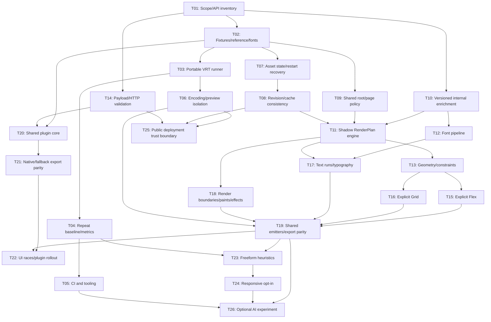

# Layoutly Implementation Roadmap

Ngày lập: 2026-10-09. Trạng thái: **đề xuất để review, chưa triển khai**.

Căn cứ: [LAYOUTLY_ARCHITECTURE_AUDIT.md](LAYOUTLY_ARCHITECTURE_AUDIT.md), findings A01-A20. Các test/build đã chạy trong audit nằm ở mục 8 của báo cáo; các test bên dưới là **tiêu chí cho công việc tương lai**, không phải kết quả đã đạt.

## 1. Nguyên tắc triển khai

- Giữ Java 17, Spring Boot, Maven, React, Vite, Tailwind CSS và TypeScript cho plugin/tooling. Không chuyển framework, không rewrite toàn bộ frontend JSX để thực hiện roadmap.
- Mỗi task là một PR nhỏ hoặc một nhóm PR được review riêng; nếu phạm vi quá lớn, tách theo fixture/call site trước khi làm. Không gộp security, schema, engine và plugin UI trong một PR.
- Không xóa/reset/ghi đè hoặc tự động commit thay đổi của người dùng. Working tree hiện có 14 file tracked đã sửa và hai Java source/test mới; thống nhất ownership trước khi triển khai các file trùng phạm vi.
- Giữ raw JSON và snapshot gốc. Không tự cập nhật expected IR, reference PNG hoặc browser golden khi test fail.
- Ưu tiên explicit Figma metadata và deterministic rules. Heuristic chỉ opt-in, có evidence/confidence/fallback; AI không tham gia trước gate baseline.
- Tách fidelity ở native viewport khỏi responsive reflow. Absolute cho overlay/freeform không phải mặc nhiên là lỗi.
- Không hứa giống 100%. Báo cáo pixel, geometry, font, assets, semantics và parity theo từng fixture, cùng phần chưa hỗ trợ.

## 2. Gates Và Dependency

| Gate | Điều kiện để qua | Chưa được làm trước gate |
| --- | --- | --- |
| G0: Scope | Review hai tài liệu; xác nhận ownership working tree, public API và fixture được phép sử dụng | Sửa ứng dụng hoặc gom thay đổi người dùng vào commit tự động |
| G1: Baseline | T02-T05 hoàn tất: fixtures/version/font/reference, runner portable, repeat-run noise, baseline được review và CI artifacts | Đặt mục tiêu fidelity tùy ý; tích hợp AI; đổi renderer mặc định |
| G2: Correctness | T06-T09, T14 và phần geometry T13 hoàn tất; isolation, asset recovery, revision và root parity có test | Public hosting; engine rollout rộng với dữ liệu chưa an toàn |
| G3: Engine | RenderPlan shadow + explicit Flex/Grid/text/render boundary + HTML/React parity đạt gates trên fixture tương ứng | Xóa renderer cũ; tự inference freeform toàn bộ; bỏ scaling cũ cho mọi export |
| G4: Plugin Parity | T20-T22 có native/PAGE live smoke và contract parity; capability/loss warnings rõ | Xóa Bridge entry point hoặc đổi manifest ID |
| G5: Responsive | T23-T24 có holdout, confidence/fallback và assertions responsive; có mobile oracle khi claim fidelity mobile | Gọi fit-to-width là responsive; auto chọn breakpoint bằng AI |
| G6: AI Optional | G1-G3 ổn định, G5 nếu AI giải responsive; có holdout, cost/privacy policy và measurable residual errors | AI tự sửa raw/design/schema, tự accept golden hoặc làm path bắt buộc |

G2 và G4 có thể tiến hành song song với engine sau G1. T25 là gate độc lập **bắt buộc trước public deployment**, không chờ AI. G3 có thể mở theo capability/fixture, không cần hỗ trợ mọi tính năng Figma mới bắt đầu rollout.

Sơ đồ thể hiện các dependency chính. Dependency chi tiết trong từng task là điều kiện nghiệm thu cuối; các task độc lập có thể bắt đầu sớm, nhưng thay đổi rendering chỉ được bật sau G1.

## 3. Backlog Theo Task

### T01. Chốt Scope, Ownership Và Contract Inventory

**Dependency:** không. **Findings:** A13, A20; điều kiện G0.

- Liệt kê public endpoints, query/defaults, multipart fields, DTO JSON, snapshot disk format và overload UINode/DesignNode. Ghi consumer thực tế của từng contract, không sửa contract ở bước này.
- Đối chiếu hashes/diff của working tree với người dùng; chọn phạm vi PR để không gộp code đang làm dở ngoài task.
- **Nghiệm thu:** inventory được review; phiên bản runtime/build đã ghi rõ; có procedure backup/version migration không overwrite raw.
- **Test:** golden contract từ fixture và endpoint hiện có; tests phân biệt legacy/tree với snapshot/tree. Không dùng token/design riêng tư trong fixture.

### T02. Fixture Package Có Reference Và Provenance

**Dependency:** T01. **Findings:** A05, A06, A08, A20.

- Tạo fixtures tracked với manifest, raw JSON, expected IR đầy đủ, asset hashes, licensed fonts và Figma PNG đúng root/revision/scale/crop. Tách browser golden khỏi Figma reference.
- Bắt đầu bằng microfixtures: absolute/negative origin, Flex row/column, Grid, mixed text, raster subtree và multi-page. Thêm Studio sau khi xác nhận quyền sử dụng.
- Mở rộng FixtureService theo API tương thích, không ghi đè case cũ mặc định; không lưu PAT/signed URLs. Capture reference và scale metadata riêng.
- **Nghiệm thu:** mỗi case replay offline; reference dimensions/provenance được validate; expected IR phản ánh children thực thay vì stub.
- **Test:** export/import fixture round-trip; missing/corrupt asset/font/reference fail rõ; payload scan không có credentials; reject duplicate case nếu chưa opt-in overwrite có review.

### T03. Playwright VRT Runner Portable

**Dependency:** T02. **Findings:** A05, A17.

- Thêm Node/TypeScript test tooling tracked, pin Playwright/browser/OS/fonts; backend cache/data tạm riêng. Không phụ thuộc `target/visual-check.mjs` hoặc đường dẫn npm cache của máy cá nhân.
- Generate preview, HTML ZIP và React ZIP offline; giải ZIP vào thư mục output mới, serve actual files/build. Block outbound Figma trong suite.
- Đợi fonts/images/CSS backgrounds và stable layout; freeze animation/caret; ghi console/network/page errors. Dùng native viewport trước, rồi desktop/mobile matrix.
- **Nghiệm thu:** một lệnh documented chạy trên môi trường được pin, lưu reference/actual/diff/overlay/trace; report root/target/viewport/revision rõ.
- **Test:** fixture chủ động thiếu ảnh/font, đổi bbox và gây pageerror phải fail; route/navigation smoke; không pass chỉ vì screenshot trắng hoặc iframe rỗng.

### T04. Baseline Và Quality Budgets

**Dependency:** T03. **Findings:** A05, A14.

- Chạy ít nhất 10 lần cùng commit để đo noise; tách pixel mismatch với Figma khỏi regression screenshot trong browser.
- Báo bbox, line count, assets/fonts, root dimensions, preview/ZIP parity, fallback reasons. Giữ metrics absolute/flex/grid để giải thích, không làm KPI duy nhất.
- **Nghiệm thu:** review artifacts và threshold từng case; có holdout chưa dùng để chỉnh rules. Chỉ công bố baseline đã đo, không quy đổi diff thành lời hứa “100%”.
- **Test:** intentionally shift 2px, đổi font, mất image và sai root phải được phát hiện; không mask toàn TEXT; baseline update cần approval và reason.

### T05. CI Và Tooling Tối Thiểu

**Dependency:** T04; cấu hình/lint có thể bắt đầu sau T01. **Findings:** A17.

- Pin Node/JDK/Maven/browser runner; thêm jobs backend tests, bốn module build, plugin lint và VRT artifacts. Sửa ESLint globals/typing đúng ngữ cảnh; bổ sung FE test/lint scripts có React rules.
- Không nâng đồng loạt Vite hoặc migrate toàn bộ JSX sang TS. Tách fix lint khỏi thay đổi output. Sửa Bridge watch để theo dõi UI và có typecheck phù hợp.
- **Nghiệm thu:** CI repeatable, lint thực sự bao phủ JSX/main thread/config; failure lưu diff/trace; không `--update-snapshots` tự động.
- **Test:** clean checkout runner; intentionally broken TS/JSX/UI watch; Maven tests riêng khỏi package skipTests; ghi chính xác command/exit code.

### T06. Encoding Và Preview Isolation

**Dependency:** T03; patch security có thể làm sớm sau T01. **Findings:** A01.

- Dùng encoders theo context HTML text/attribute, JS data và inline CSS/style termination. Không dùng một escape helper cho mọi context.
- Chọn sandbox hoặc preview origin riêng; scaling script phải là script do hệ thống kiểm soát. Không kết hợp `allow-scripts` và `allow-same-origin` cho srcDoc cùng origin mà coi là isolation.
- Áp dụng nhất quán web preview, fullscreen, plugin preview và HTML export; không phá input/navigation có chủ đích.
- **Nghiệm thu:** design strings không tạo attribute/script/style mới; preview không đọc parent DOM/token/storage; tương tác được cho phép vẫn chạy.
- **Test:** inert injection probes, quotes/newlines/`</style>`/`</script>`, dangerous URL schemes, Playwright parent-access check và scaling/navigation tests. Không thử payload trên dữ liệu người dùng.

### T07. Asset State Và Restart Recovery

**Dependency:** T02. **Findings:** A02, A15.

- Phân biệt UNKNOWN/PARTIAL/COMPLETE theo expected node IDs, byte files và hash; bundle non-null không đồng nghĩa complete.
- Reader snapshot cũ suy ra trạng thái an toàn; REST thiếu bytes có recovery/token prompt rõ, plugin thiếu asset có warning và yêu cầu sync lại. Không tự gọi mạng từ VRT.
- **Nghiệm thu:** restart trước download không cache bundle rỗng như complete; missing files không còn URL “thành công”; failed assets giữ diagnostics per node.
- **Test:** reproduce expected1/present0 trước và sau restart; partial download, null render URL, corrupted bytes; strict export fail rõ và permissive export có warnings theo compatibility plan.

### T08. Revision Và Cache Consistency

**Dependency:** T07. **Findings:** A03, A20.

- Asset URLs theo content/revision; pin tree/render revision khi API hỗ trợ, hoặc phát hiện mismatch và cảnh báo. Versioned derived output không ghi đè raw cũ.
- Tách publish snapshot khỏi save transaction; kiểm soát in-flight refresh/export và cache lookup theo file/root/source. Sửa full-snapshot lookup filter trước max.
- **Nghiệm thu:** refresh không trả ảnh cũ với immutable URL; old request không ghi đè manifest mới; restart không trộn revision.
- **Test:** latch-controlled refresh/export race, interrupted persistence, cache root selection, browser cached asset refresh; legacy snapshot reader và rollback về previous derived version.

### T09. Root/Page Policy Dùng Chung

**Dependency:** T02, T01. **Findings:** A04, A19.

- Tạo resolver cho explicit selection, DOCUMENT/CANVAS wrapper, default screen heuristic và page partition. Ghi decision/provenance; explicit root thắng heuristic.
- Controller/HTML/React dùng cùng policy qua facade hiện có; nếu thay default, flag opt-in và thông báo compatibility riêng.
- **Nghiệm thu:** preview, HTML ZIP, React ZIP cùng roots/page count, coordinate origin và link targets cho cùng request.
- **Test:** selected nested frame trong cover, single/multi-frame CANVAS, empty root, native/plugin wrapper và invalid root. Test HTTP + generated output, không chỉ title string.

### T10. Versioned Internal Enrichment

**Dependency:** T01, T02. **Findings:** A06-A10, A13, A20.

- Đề xuất RFC cho normalized internal document/sidecar theo node ID: provenance, units, local transforms, Grid, text runs, masks/effects, source asset versus rasterized node.
- Giữ public DesignNode/UINode và endpoint contract mặc định; raw JSON là nguồn tái xử lý. Không tạo round-trip giả rằng UINode giữ đủ layout metadata.
- **Nghiệm thu:** reader hỗ trợ snapshot cũ, version marker cho parser/serializer/derived plan; legacy projection có loss diagnostics, không silently replace core IR bằng UINode.
- **Test:** golden public DTO, old snapshot load, DesignNode -> legacy contract, enrichment repeatability; unknown additive fields không phá reader cũ.

### T11. Shadow RenderPlan Engine

**Dependency:** T10, T09, T08, G1. **Findings:** A04, A13, A14, A19.

- Thêm Java package nội bộ `service/layout`; contract `infer(document, pages, options, assets) -> RenderPlan` với geometry, flow, sizing, text, paints, identity và diagnostics.
- Các decisions giữ ruleId/sourceFields/reason/confidence/fallback; chưa thay response mặc định. Chạy shadow đối chiếu với generator cũ.
- **Nghiệm thu:** cùng input/version ra cùng plan; không có hidden I/O hoặc AI; old API/generator vẫn dùng được bằng flag.
- **Test:** deterministic plan golden, absent/unsupported metadata, concurrent invocation, output no-change khi flag off; diagnostics không chứa PAT/signed URLs.

### T12. Font Manifest Và Font Loading

**Dependency:** T02, T10. **Findings:** A06.

- Map family/style/weight tới font được phép phân phối; manifest ghi license/hash. Không tự download hoặc nhúng font bản quyền không rõ nguồn.
- Shared CSS emitter sinh @font-face và packaging paths; xác nhận required faces thực sự available, không chỉ chờ `document.fonts.ready`.
- **Nghiệm thu:** preview và ZIP cùng font bytes/weight; font thiếu được báo rõ hoặc fixture blocked, không silently tính fidelity bằng fallback.
- **Test:** font path trong HTML/React ZIP, offline decode, missing weight, wrap/bbox với font đúng và cố tình fallback.

### T13. Geometry Và Constraints Normalization

**Dependency:** T11. **Findings:** A10, A14.

- Validate finite bounds và parent dimensions; normalize local coordinates, root offsets, visible/overflow geometry, arbitrary transforms hoặc explicit raster fallback.
- Không cho heuristic 95% full-bleed ghi đè constraints rõ. SCALE parent zero có diagnostic, không sinh Infinity/NaN hoặc NPE.
- **Nghiệm thu:** negative origin và hidden descendants không làm đổi page dimensions ngoài policy; anchors theo Figma metadata.
- **Test:** probe partial bounds hiện fail, zero parent, LEFT/RIGHT/CENTER/STRETCH/SCALE, rotation, overflow/clipsContent, offset root; bbox assertions và VRT.

### T14. Payload Và HTTP Validation

**Dependency:** T01, T02. **Findings:** A16, A11.

- Validate IDs theo REST/plugin syntax gồm composite instance IDs; node membership, duplicate IDs, depth/node/pixel budgets, filename/path, byte signature/MIME và SVG safety.
- Validate format/root và multipart; dùng HTTP4xx cho invalid input thay vì generic500. Thay status/default chỉ theo contract migration được review.
- **Nghiệm thu:** malformed/untrusted payload fail bounded trước traversal/render; status/body ổn định và tương thích nơi cần.
- **Test:** MockMvc hoặc HTTP integration cho multipart/CORS/errors; deep/oversized/duplicate/mismatched assets, composite IDs, malformed SVG và unknown export format. Giới hạn trong temp fixtures.

### T15. Explicit Auto Layout Flex

**Dependency:** T13, T10; visual acceptance cần T12. **Findings:** A12.

- Map direction, alignment, wrap/cross-axis gap, padding, HUG/FILL/FIXED/minmax và layoutPositioning; giữ ABSOLUTE overlays ngoài flow.
- Dùng browser Flexbox để giải layout, không viết lại browser solver trong Java. Negative itemSpacing cần policy overlap riêng, không emit invalid gap.
- **Nghiệm thu:** native viewport khớp microfixtures; mixed sizing không default shrink sai; resize trong phạm vi constraints có geometry đúng.
- **Test:** row/column, nested hug/fill, fixed sibling+fill, wrap, baseline align, negative gap, padding/minmax, absolute child. Unit plan + CSS validity + VRT.

### T16. Explicit Grid

**Dependency:** T13, T10. **Findings:** A07.

- Preserve tracks/counts/gaps/placement/spans/anchors theo schema Figma thực; normalize sang GridPlan typed, không chèn raw CSS tùy ý.
- **Nghiệm thu:** AUTO_GRID có display:grid và đúng placement; unsupported field tạo diagnostic/fallback, không chỉ tăng count UI.
- **Test:** mixed tracks, spans, minmax/auto, nested grid, explicit positions, overlay; native/resized screenshots và CSS parse/validation.

### T17. Text Runs Và Typography

**Dependency:** T12, T11. **Findings:** A06, A09.

- Giữ character style overrides/runs, font style/weight, letter spacing/line-height units, paragraph/decoration/case/truncation và vertical alignment.
- Map text shadow tới glyph behavior; shared typed text plan cho HTML/JSX. Không convert ký tự và style bằng nối chuỗi không escape.
- **Nghiệm thu:** run order/text chính xác; wrap/line count/vertical placement đúng fixture; unsupported text feature có diagnostic.
- **Test:** mixed fonts/weights, percent/intrinsic line height, Unicode/quotes/newlines, baseline/vertical align, ellipsis và text shadow/stroke; VRT font-pinned.

### T18. Render Boundaries, Paints Và Effects

**Dependency:** T11, T13, T07. **Findings:** A09, A15.

- Phân biệt source image fill với bitmap render cả subtree. Raster boundary chỉ vẽ một lần; children giữ metadata nhưng không double-paint hoặc áp opacity hai lần.
- Preserve paint order/mask scope/effects; native CSS khi deterministic, SVG/raster fallback có provenance khi không biểu diễn đủ. Không đặt blanket raster cho cả trang.
- **Nghiệm thu:** render bounds/crop/mask không cắt shadow hoặc nhân đôi children; degraded capability hiển thị diagnostic.
- **Test:** image-filled frame có text con, opacity nested, drop/inner/text shadow, gradient, blur, sibling mask, ellipse/vector và clipping. REST/native/fallback asset parity fixtures.

### T19. Shared Emitters Và Export Parity

**Dependency:** T06, T09, T15-T18, T14. **Findings:** A04, A13, A14, A19.

- HTML và React consume RenderPlan, shared CSS/identity/traversal/page link semantics; giữ facades service và legacy overloads. Migrate từng target/call site theo flag.
- Tách common scaling runtime khỏi quyết định responsive; BUTTON/input/link/transition dùng cùng semantic plan. Không claim SMART_ANIMATE parity khi chỉ fade.
- Packaging tests cho relative assets/font paths, multi-page routes, HTML file usage và React build/serve. Chọn pinned template dependencies/lock strategy để export tái lập.
- **Nghiệm thu:** cùng root/revision/fonts có preview/HTML/React parity theo budget; old default vẫn rollback được; clean exported React install/build có job riêng thực sự chạy.
- **Test:** VRT ba targets, interaction/keyboard, nested link, iframe isolation, ZIP entries/path safety, deep route reload. `npm ci` chỉ dùng khi exported lockfile hợp lệ; nếu chưa có lock ghi rõ clean install chưa deterministic.

### T20. Shared Plugin Export Core

**Dependency:** T02, T14, T01. **Findings:** A08, A17.

- Trích TS protocol/types và pure export helpers nhỏ; hai plugin entry points cùng gọi core. Giữ manifest IDs, React UI và Bridge HTML UI/build hiện tại.
- Shared core không phụ thuộc DOM; fetch/multipart nằm UI transport. RequestId/progress/result/capabilities có contract typed; additive protocol tương thích backend cũ.
- **Nghiệm thu:** build cả hai plugin; output fixture tương đương phần trước khi trích; không thay plugin installation identity.
- **Test:** unit helpers với Figma API doubles, protocol golden, network access manifests, build/watch; chưa coi mock là live API validation.

### T21. Native Export Và Fallback Parity

**Dependency:** T20, T10, T18. **Findings:** A08, A06, A09.

- Dùng JSON_REST_V1 khi supported, kể cả PAGE theo API/lifecycle chính thức; load page phù hợp. Không mặc định PAGE phải manual serialization.
- Manual fallback có capabilities/field-loss warnings, cùng metadata cho reference scale/crop và asset provenance. Budget/concurrency/cancellation rõ, không silently drop asset/reference.
- **Nghiệm thu:** native và fallback replay cùng root được so trên raw/enriched fields và visual; phần không tương đương được nêu rõ, không tự bịa field.
- **Test:** Figma Desktop live smoke selected FRAME/PAGE/mixed text/grid/effects; mock API export failure, mixed symbols, oversized reference và asset error; lưu fixture sạch, không PAT.

### T22. UI Correctness Và Plugin Rollout

**Dependency:** T21, T19, T05. **Findings:** A18, A17.

- Backend URL configurable, progress/loss diagnostics và Open Layoutly flow; cancel/ignore stale imports/code/structure ở mọi await, gắn result với snapshot+requestId hiện tại.
- Test token gọi validation thật hoặc đổi nhãn không giả “connected”; ghi rõ AI suggestions hiện là static hoặc bỏ nhãn gây hiểu nhầm. Không tích hợp AI trong task này.
- Giữ Bridge entry point đến khi parity/live tests và users xác nhận; deprecation notice trước khi xóa, không auto migrate plugin ID.
- **Nghiệm thu:** cả hai plugin tiếp tục dùng được; React/HTML status đúng; đổi tab/import nhanh không hiển thị output snapshot cũ.
- **Test:** component/API tests với delayed/out-of-order responses, debounce, repeated sync, offline backend và failed token; manual Figma Desktop acceptance.

### T23. Freeform Layout Heuristics Có Fallback

**Dependency:** T19, T04. **Findings:** A14, A10.

- Opt-in inference row/column/grid theo alignment/gaps/repetition/overlap, chỉ vùng không explicit metadata; preserve stacking và semantic order.
- Decision trace/confidence threshold; ambiguous giữ absolute. Hiệu chỉnh confidence trên reviewed fixtures, không gọi score là probability khi chưa calibrated.
- **Nghiệm thu:** không regress fidelity budget, holdout có lợi ích đo được; no-change cho explicit Flex/Grid và freeform graphic cần absolute.
- **Test:** aligned cards, uneven spacing, overlapping hero, decorative vectors, ambiguous regions; false-positive fixtures; ablation từng rule và fallback VRT.

### T24. Responsive Reflow Opt-In

**Dependency:** T23, T15-T17, T09. **Findings:** A14.

- RenderOptions tách FIDELITY_FIXED/RESPONSIVE_REFLOW; dùng mobile frame mapping được review khi có. Breakpoints/rules explicit trước heuristics.
- Không thu nhỏ toàn desktop bằng transform rồi gọi mobile reflow; vẫn giữ fit-to-width cho preview fidelity nếu user chọn.
- **Nghiệm thu:** desktop fidelity không đổi; mobile no unexpected overflow/overlap, text/control readable; so Figma mobile chỉ khi có oracle tương ứng.
- **Test:** 1440/1280/768/430/390/375, text dài, minmax, keyboard/navigation, mobile mapping và absent mobile oracle. Expected overlaps whitelist từng node, không cả page.

### T25. Public Deployment Trust Boundary

**Dependency:** T06, T08, T14. **Findings:** A11, A20. **Bắt buộc trước public hosting.**

- Quyết định local-only hay multi-user. Nếu local-only, documented binding/origin policy và không expose ngoài ý muốn; nếu public, auth/owner scope snapshot/cache/assets, token lifecycle và resource limits.
- Không coi CORS là authentication; kiểm tra rule global/Bridge thực qua HTTP preflight. Không log hoặc persist PAT trong fixture/report; tenant cache không được reuse chỉ bằng fileKey.
- **Nghiệm thu:** unauthorized user không đọc/export/refresh snapshot của người khác; permitted plugin origins vẫn sync; memory/disk/cache có bound và retention policy.
- **Test:** owner A/B, expired credentials, CORS allowed/disallowed/null origin, token redaction, throttling và asset access. Session changes có API migration riêng, không âm thầm phá local clients.

### T26. AI Experiment, Không Phải Core Dependency

**Dependency:** G1-G3; T24 nếu giải responsive; privacy/cost review. **Findings:** residual gaps sau baseline, không dùng AI để che A01-A12.

- Chỉ chọn một bài toán có baseline deterministic: semantic grouping hoặc đề xuất ambiguous layout. Structured output qua validator; rules/constraints có quyền veto và fallback.
- Holdout evaluation so với no-AI và heuristics-only, cùng fixture/fonts/browser. Không gửi raw private design hoặc credentials ra ngoài khi chưa có consent/policy.
- **Nghiệm thu:** cải thiện measurable trên holdout mà không regress hard constraints/security; latency/cost được ghi; default vẫn chạy offline không AI.
- **Test:** malformed/hallucinated IDs, nondeterminism, timeout, unavailable model, prompt injection từ layer names; no-baseline-auto-update. Nếu không cải thiện thì dừng experiment, không ép integration.

## 4. Compatibility Và Rollback

| Bề mặt | Kế hoạch giữ tương thích | Điều kiện trước thay đổi |
| --- | --- | --- |
| REST/Bridge endpoints | Giữ paths/parts/headers và defaults cũ; thêm option/version theo RFC | Golden DTO + HTTP integration với clients hiện tại |
| DesignNode/UINode | Enrichment nội bộ, legacy projection; không coi adapter là lossless | Tests public JSON/constructors/overloads; loss diagnostics |
| Snapshot disk | Reader legacy, manifest có version; derived output theo engine version riêng | Fixtures snapshot cũ; restore/migration/rollback; không overwrite raw |
| Asset URLs | Content/revision URL mới và reader URL cũ trong retention window | Browser cache test; missing-file recovery và access-control policy |
| Generator | Old/new qua flag; preview/export cùng version chọn | VRT/native root parity, no-change flag off, rollback không mất artifacts |
| Plugin protocol/ID | Core dùng chung, envelope additive; giữ hai entry points và IDs | Backend/client skew tests + Figma Desktop live smoke |
| Exported React | Giữ JSX/CSS/Vite flow; pinned dependency strategy riêng | Clean install/build/serve + multi-page route tests |

Nếu task yêu cầu thay schema/public API ngoài kế hoạch trên, dừng để review RFC: consumers, defaults, migrations, rollback, version marker và contract tests. Không “sửa tiện” API trong PR layout.

## 5. Thứ Tự PR Đề Nghị

1. T01 và T02: chốt phạm vi, fixture đầu tiên, reference/fonts và contract inventory.
2. T03-T05: runner, đo baseline, CI artifacts. T06/T07/T14 có thể làm song song vì không cần inference mới.
3. T08-T10 và T12: cache/root/data contract/font; giải các lỗi nền trước thay output.
4. T11/T13 rồi T15-T18: shadow engine; một capability + microfixtures mỗi PR. Renderer cũ còn là default.
5. T19: rollout từng target với parity; đo lại Studio và holdout, không tự cập nhật golden để pass.
6. T20-T22: trích core hai plugin, native/PAGE parity, UI correctness; chỉ deprecate Bridge sau acceptance.
7. T23-T24: heuristic/responsive opt-in với report và fallback. T25 hoàn tất trước mọi hosting không tin cậy.
8. T26 chỉ khi có residual problem phù hợp và baseline chứng minh lợi ích cần AI.

Không ấn định số tuần trước khi có fixture/provenance/font và G0-G1. Rủi ro lịch chính là font licensing, Figma live export parity, mask/raster strategy và API migration; không phải riêng số dòng code engine.

## 6. Mapping Findings Sang Tasks

| Finding | Tasks chính |
| --- | --- |
| A01 isolation/encoding | T06, T14, T25 |
| A02 restart assets | T07, T08 |
| A03 revision/cache | T08, T19 |
| A04 root/page parity | T09, T11, T19 |
| A05 baseline | T02-T05 |
| A06 typography/fonts | T10, T12, T17, T21 |
| A07 Grid | T10, T16 |
| A08 Bridge data loss | T20-T22 |
| A09 masks/raster/effects | T10, T17, T18, T21 |
| A10 geometry/constraints | T13, T23 |
| A11 trust boundary | T14, T25 |
| A12 Flex | T15 |
| A13 adapters | T01, T10, T11, T19 |
| A14 scaling/duplication | T04, T11, T19, T23, T24 |
| A15 partial download | T07, T18 |
| A16 validation | T14 |
| A17 tooling/build | T03, T05, T20, T22 |
| A18 UI status/races | T22 |
| A19 semantics/prototypes | T09, T19 |
| A20 snapshot reproducibility | T01, T08, T10, T25 |

## 7. Definition Of Done Cho Mỗi PR

- Diff đúng task, không lấy hoặc revert thay đổi người dùng ngoài phạm vi; không tự commit.
- Command, environment, exit code, tests ran/skipped và artifacts được ghi chính xác.
- Có focused unit/contract tests; rendering thay đổi có reference/regression evidence phù hợp, không chỉ assert chuỗi CSS.
- Unsupported fields có diagnostic/fallback; không nâng capability count UI khi chưa render đúng.
- Schema/API thay đổi có compatibility review, legacy test và rollback.
- Không mất raw/reference/font provenance, không lộ token, không gọi API ngoài trong suite offline.
- Không tuyên bố fidelity/responsive/plugin parity vượt phạm vi test thực sự chạy.

## 8. Quyết Định Cần Review Trước Triển Khai

1. Chọn fidelity native viewport là mục tiêu đầu tiên; responsive là mode riêng hay đổi default về sau?
2. Cho phép đưa Studio và bộ font/assets tương ứng vào fixtures không, hay dùng microfixtures tự tạo trước?
3. Duyệt giữ React plugin là UI chính và Bridge làm entry point tương thích trong giai đoạn parity?
4. Backend chỉ dùng local hay có kế hoạch multi-user/public? Câu trả lời quyết định scope T25, không bỏ gate security.
5. Duyệt thứ tự T01-T07/T14 trước khi sửa engine, và thống nhất ownership các file đang có thay đổi chưa commit.

Các câu hỏi này là điểm review thiết kế; **không có sửa code ứng dụng nào được triển khai tự động cùng hai tài liệu audit**.
