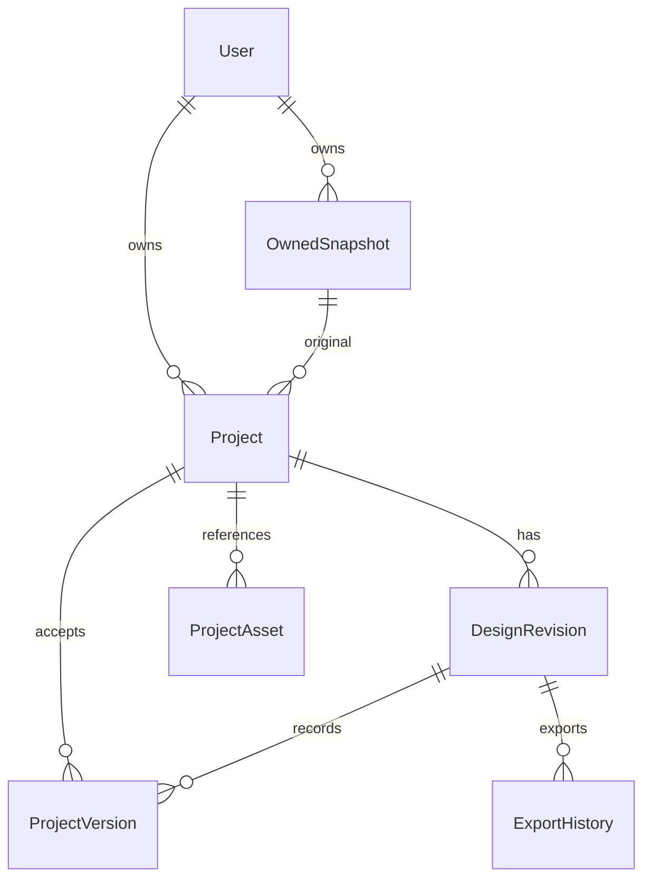

# Layoutly Phase 2 Contracts And Migration

> Cập nhật chính thức 16/10/2026: chọn PostgreSQL, không dùng MySQL. Các contracts lịch sử dưới đây được đối chiếu bằng [triển khai, API và kết quả test hiện hành](LAYOUTLY_POSTGRESQL_AUTH_PROJECTS.md); không dùng các mô tả “chưa triển khai” làm trạng thái hiện tại.

Ngày: 2026-10-09. **Đề xuất, chưa triển khai backend/DB.** Cần duyệt sau Phase 1. Không thay thế audit/roadmap A01-A20 và không cho phép public hosting trước khi qua security gates.

## 1. Hạ Tầng Tại Thời Điểm Lập Đề Xuất

- Java 17 / Spring Boot 3.3.2 / Maven; chưa có Spring Security, JPA/JDBC, PostgreSQL driver hoặc Flyway trong `layoutly-be/pom.xml`.
- `SnapshotStorageService` đang lưu raw JSON, IR, metadata, assets/reference theo snapshot trên đĩa. API snapshot/cache chưa có owner isolation. Không có user/project database để migrate lúc này.
- Frontend React 18 / Vite 5 / Tailwind 3; Phase 1 thêm auth UI và capability gate, không tạo tài khoản/session/project demo.
- Quyết định chính thức đã chọn PostgreSQL 16, Flyway và Spring Data JPA. Xem hướng dẫn hiện hành để chạy Compose và migration có kiểm soát.

## 2. Dependency Và Acceptance

| Task Phase 2 | Dependency | Nghiệm thu / tests bắt buộc |
| --- | --- | --- |
| P2.1: RFC/trust/storage | Duyệt Phase 1 và tài liệu này | Chốt local-only/hosted, terms version, backup/retention, owner binding, Bridge pairing; snapshot public API không bị đổi âm thầm |
| P2.2: DB migrations | P2.1, PostgreSQL test environment | Flyway + Spring Data + driver đúng versions Boot; apply trên DB trống, migration replay, FK isolation, rollback operational plan; không dùng ddl-auto=update |
| P2.3: Security/session | P2.2; A01/A11 gate | Spring Security, password encoder, CSRF, session fixation/expiry, rate limits; register/login/logout/me và cross-user tests; capability chỉ bật khi service hoạt động |
| P2.4: Owned storage | P2.3; A02/A03/A20 | Owner-filter mọi snapshot/assets/cache/preview/export; restart/missing files; snapshot immutable cho project; không reuse cache across users chỉ bằng fileKey |
| P2.5: Projects/revisions | P2.4 | CRUD/duplicate/trash/restore; save/reopen/restart; optimistic concurrency; accepted revision export; no arbitrary disk path từ client |
| P2.6: Dashboard wiring | P2.5 | Grid từ API thật, empty/loading/error, filters/sort/search/pagination; không project cards hardcode |
| P2.7: End-to-end acceptance | P2.3-P2.6 | Register -> Login -> import -> save -> logout -> login -> reopen -> preview -> export; restart và owner A/B |

Phase 2 không tích hợp AI. DesignRevision/ProjectVersion tạo nền cho editable state, nhưng structured edit commands/AIConversation/AIMessage triển khai ở Phase 4 sau baseline; không tạo tables rỗng chỉ để claim có AI.

## 3. Auth Contract V1

**Chưa có các endpoint dưới đây trong backend hiện tại.** Frontend Phase 1 nhận404/501 từ capabilities là unavailable và không gửi credentials. Các positive tests của client dùng mock để kiểm contract, không chứng minh auth backend đã triển khai.

```json
GET /api/auth/capabilities
{
  "contractVersion": 1,
  "login": true,
  "registration": true,
  "passwordReset": false
}
```

Cap chỉ `true` khi đầy đủ service/database/security/terms đã mở. Boolean string không được chấp nhận. OAuth luôn ẩn trong Phase 1; không mở nút chỉ vì có tên provider trong config.

| Endpoint đề xuất | Request / response | Security |
| --- | --- | --- |
| GET `/api/auth/csrf` | `{ "headerName": "X-CSRF-TOKEN", "token": "..." }` | Same-origin, no-store; cookie/session theo config; token không log |
| POST `/api/auth/register` | displayName, email, password, acceptedTermsVersion;201 `{user}` nếu tạo session thành công | CSRF; unique canonical email; hashed password; rate limit; capability off trước terms chính thức |
| POST `/api/auth/login` | email, password, rememberMe;200 `{user}` | CSRF; session rotation;401 generic; no plaintext password logging |
| GET `/api/auth/me` |200 `{user}` hoặc401 | No-store; authenticated identity authoritative |
| POST `/api/auth/logout` |204; invalidates session/remember-me | CSRF; frontend xóa private cached views; không lấy GET làm logout |
| POST `/api/auth/forgot-password` | email;204 dù email có tồn tại hay không | Chỉ bật khi email delivery/config hoạt động; rate limit |
| POST `/api/auth/reset-password` | one-time token + newPassword;204 | Hashed expiring reset token; one use; no token in logs/fixtures; invalidate sessions theo policy |

User DTO chỉ `{id, displayName, email, createdAt}`. Không password hash/PAT/provider secrets. Frontend client đã prepare login/register/forgot + CSRF handshake; me/logout/reset, session context và Dashboard thuộc Phase 2.

Chọn password encoder và giới hạn server theo RFC security; frontend đăng ký dùng12-128ký tự hiện tại. Không dùng bcrypt trực tiếp với input vượt giới hạn byte mà bỏ qua truncation. Session cookie HttpOnly, SameSite theo deployment; Secure trên HTTPS; CSRF và Origin checks không thay authentication. Remember-me không lưu password/token trong localStorage.

## 4. Domain Và Storage Boundaries



| Entity | DB metadata | File/object storage |
| --- | --- | --- |
| User | UUID, canonical email, displayName, passwordHash, timestamps | Không credentials files |
| OwnedSnapshot | ownerId, snapshot UUID/key, source, manifest/hash/version | Immutable raw/IR/assets/reference; reuse SnapshotStorageService qua ownership facade |
| Project | ownerId, name, originalSnapshotId, selectedRoot, currentAcceptedRevisionId, optimistic version, trashedAt, timestamps | Thumbnail reference có hash, không client-supplied filesystem path |
| DesignRevision | projectId, parentId, sequence, DRAFT/ACCEPTED/REJECTED, manifest path/hash, engine/parser version | Immutable derived IR/edit state/navigation/assets manifests |
| ProjectVersion | projectId, revisionId, label, createdAt | History record trỏ revision; restore tạo accepted revision/version mới |
| ProjectAsset | projectId, nodeId, hash/MIME/size, storageKey | Bytes; dedup chỉ sau authorization; source/render provenance |
| ExportHistory | projectId, revisionId, format/settings/status/hash, createdAt | ZIP, retention policy; không raw PAT |

PostgreSQL lưu DesignNode và metadata bằng JSONB. Images/fonts/ZIP lớn dùng storage key do server tạo và kiểm containment. DB giữ manifests/hash và authorization; metadata nhỏ vẫn có budget.

Original Figma snapshot của project immutable. Service refresh hiện tại có thể thay cùng snapshotId; không gắn mutable REST snapshot trực tiếp làm original rồi cho refresh phá history. Khi save vào project, freeze bản có ownership/manifest riêng; refresh/import tạo revision mới. Không overwrite raw cũ khi parser/schema đổi.

DB FK phải bảo đảm `project.originalSnapshot.owner == project.owner` và revision/parent/current revision thuộc cùng project; không chỉ dựa kiểm UUID tồn tại. Mọi lookup repository có owner trong predicate, gồm thumbnail/assets và ExportHistory. FK giúp consistency, không thay authorization.

## 5. Project API Đề Xuất

Prefix `/api/projects` là namespace mới; không thay shape endpoint snapshot/tree cũ trong Phase 1.

| Endpoint | Hành vi |
| --- | --- |
| GET `/api/projects?q=&format=&sort=updatedAt,desc&state=active&page=0&size=24` | Paged owner-filtered list; include id/name/thumbnail/exportFormat/updatedAt/currentRevisionId/version; cap page size |
| POST `/api/projects` | name, authorizedSnapshotId, selectedRoot, exportSettings;201 + ProjectDetail + ETag |
| GET `/api/projects/{id}` | Detail/current accepted revision + ETag;401 unauthenticated,404 khi không thuộc owner |
| PATCH `/api/projects/{id}` | Rename/settings; require If-Match optimistic version |
| POST `/api/projects/{id}/duplicate` | Bản sao của cùng owner, new project/revision IDs; immutable bytes ref-counted theo policy |
| DELETE `/api/projects/{id}` | Soft delete; history/assets chưa xóa ngay |
| POST `/api/projects/{id}/restore` | Restore soft-deleted project với concurrency check |
| GET `/api/projects/{id}/versions` | Paged history có revision/label/time |
| POST `/api/projects/{id}/versions/{versionId}/restore` | Tạo revision/version mới, không sửa history cũ |
| GET `/api/projects/{id}/preview?revisionId=...` | Render authorized specified revision; default accepted; HTML và assets cô lập |
| GET `/api/projects/{id}/export?revisionId=...&format=HTML&type=AUTO` | Same accepted design/navigation/assets state như preview; strict asset validation |

If-Match stale ->412; missing required precondition ->428; invalid command/settings ->400; operation conflict ->409. Error DTO gồm stable `code`, safe `message`, `requestId`; không trả stack/path/credentials. Project version counter tăng atomic trong transaction; update count0 không silently last-write-wins.

Export và preview mặc định accepted revision; draft chỉ khi request chủ động và authorized. ExportHistory ghi revision ID và manifest hash trước stream; không cho generator đọc mutable “latest” giữa quá trình đóng ZIP.

## 6. Migration Không Phá Snapshot Cũ

1. Backup **copy** data directory và DB trước migration; hashes/inventory. Không xóa, move hoặc overwrite snapshot gốc. Chạy test migration trên bản sao/tạm.
2. Flyway tạo schema/version table mới; app không tự sửa schema bằng hibernate ddl-auto. Hạ tầng PostgreSQL, TLS/secret config và test instance được xác nhận trước.
3. OwnedSnapshot index liên kết file manifest với owner; legacy snapshots **không tự thuộc bất kỳ user mới đăng ký nào**. Import/claim chỉ được phép qua explicit local-admin migration/pairing có provenance, không endpoint claim UUID tùy ý.
4. Wrap SnapshotStorageService bằng owner-aware facade. Tất cả controllers đọc snapshot/assets/preview/export phải đi facade trong secured profile; không chỉ bảo vệ ProjectsController.
5. Local compatibility profile giữ workflow cũ trong phạm vi localhost có cảnh báo; hosted profile deny legacy anonymous access. Tách cache theo owner/revision; session khác owner không thể lấy cached file bằng fileKey.
6. Bridge trong secure profile cần pairing: logged-in web tạo short-lived, scoped import grant; plugin exchange/pair, then upload vào owner/project. Không dựa third-party session cookies trong Figma iframe; không cho `null` origin trở thành public authentication bypass.
7. Migrate selected roots/manifests qua reader versioned; missing asset bytes ->PARTIAL, không fake COMPLETE. Parser upgrade tạo derived artifact theo version mới, giữ raw/ref unchanged.
8. Switch frontend capability booleans sau khi deploy các endpoints/tests tương ứng; account session authoritative qua `/me`; cập nhật redirect sau login sang Dashboard.
9. Rollback app giữ reader/storage cũ và tắt capability; DB migrations forward-compatible. PostgreSQL hỗ trợ transactional DDL; rollback ứng dụng và file storage vẫn cần quy trình độc lập. Restore backup có procedure, không chạy down migration tự động trên dữ liệu thật.

## 7. Quality Gates Trước Bật Capability

- Backend JUnit + HTTP/MockMvc tests chạy trên PostgreSQL thật trong test instance hoặc Testcontainers nếu hạ tầng cho phép; không gọi H2 pass là PostgreSQL parity.
- Register/login/logout/expiry/CSRF/remember-me; email enumeration/rate-limit; server validation khớp frontend; OAuth/reset hidden khi config thiếu.
- Owner A/B với project, snapshot, asset, preview, export, versions, duplicate/restore, cached response. Không thử trên design private của người dùng.
- Save/reopen/restart với disk asset hashes; interrupted DB/storage commit có reconciliation, không publish project trước manifest commit.
- Frontend tests và Playwright workflow từ tài khoản mới không seeded demo projects. Empty state trước import.
- VRT baseline riêng vẫn bắt buộc trước engine/AI. Phase 1 screenshot smoke không đóng G1 và không chứng minh 100% Figma fidelity.

**Tài liệu này là contracts/migration preparation, không phải tuyên bố Phase 2 đã hoàn tất.**
